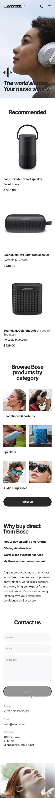
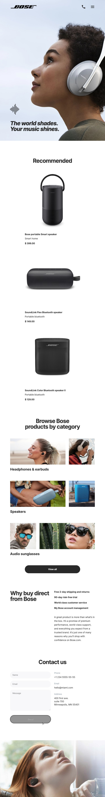
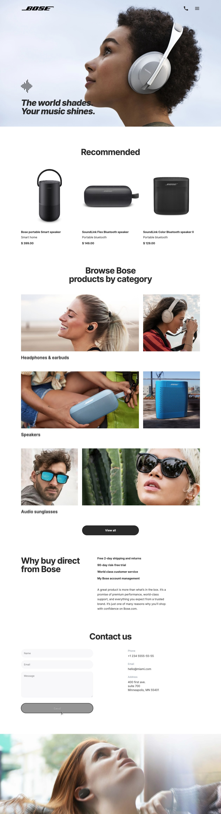
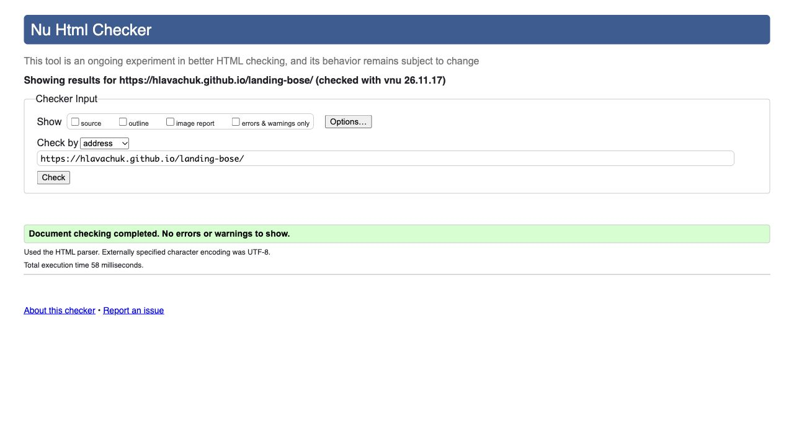
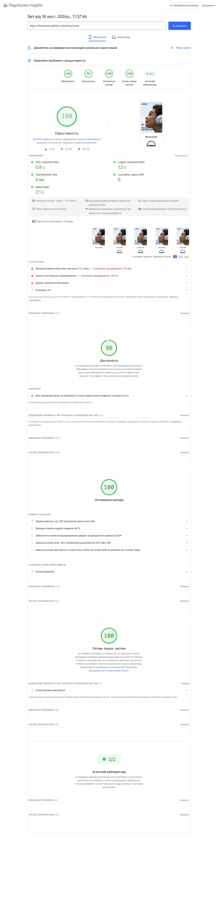
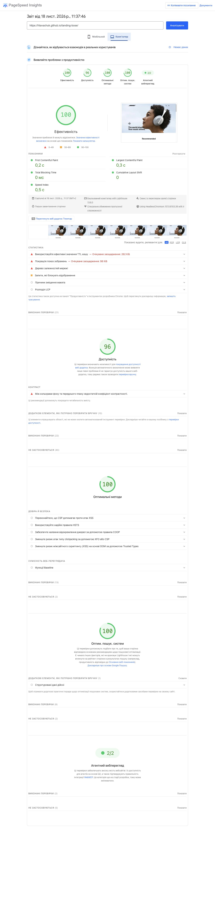

# Лабораторна робота №10 — Bose

Номер у списку: **6**. Варіант: **3**, BEM + каскадні шари `@layer`.

- [Демо — GitHub Pages](https://hlavachuk.github.io/landing-bose/)
- [Макет Figma — v2 Bose](https://www.figma.com/design/xIVUXiPZ3hdpEFiIC0qbTL/BOSE-New-Version?node-id=6703-88)
- [Вимоги лабораторної](https://github.com/Computer-Science-Department-ChNU/web-technologies/blob/main/html-css/labs/lab-10/lab-10.adoc)

## Запуск

Потрібен Node.js 24.15+ LTS.

```sh
npm install
npm run dev
npm run build
npm run preview
npm run lint
npm run format
npm run images
```

Збірка взята з лабораторної №9: Vite, Pug, Sass, PostCSS/Autoprefixer, Browserslist, Prettier, Stylelint, Husky та lint-staged. Власного JavaScript у сторінці немає. Скрипти в `scripts/` працюють лише під час підготовки ресурсів. Публікація виконується через `.github/workflows/pages.yml`.

## Завдання 1. Ресурси та дизайн-токени

Фотографії, логотип, іконки й кадри для різних ширин експортовані з Figma. Фотографії підготовлено з експортів 2x; Sharp створює AVIF, WebP і JPEG, декілька розмірів та окремі кадри для мобільної й планшетної версій. SVG оптимізовано SVGO. Логотип містить оригінальне зображення, вбудоване у SVG самим макетом.

Шрифт — локальний **Inter 3.19**: Regular 400, Bold 700, ExtraBold Italic 800. WOFF2 містять потрібні символи; використано `font-display: swap` та preload. Ліцензія — `public/fonts/LICENSE.txt`.

Токени зберігаються у `src/styles/abstracts/_tokens.scss`; кольори також доступні як CSS custom properties у шарі `base`.

| Параметр                         | Значення                                                 |
| -------------------------------- | -------------------------------------------------------- |
| Основний текст                   | `#292929`                                                |
| Фон                              | `#ffffff`                                                |
| Меню                             | `#e8eff9`                                                |
| Поля форми                       | `#f8f8fa`                                                |
| Заголовки 320 / 744 / 1260       | 32 / 40 / 48 px, line-height 100%, tracking −1.5 px      |
| Hero                             | Inter 800 Italic                                         |
| Основний текст                   | 16 px; картки — 22 px line-height, абзац переваг — 27 px |
| Відступи секцій                  | 96 px на мобільному, 120 px на планшеті й десктопі       |
| Кнопка / поле / textarea         | висота 56 / 48 / 148 px                                  |
| Радіуси кнопки / поля / textarea | 40 / 40 / 16 px                                          |
| Брейкпоінти                      | 744 / 1260 px                                            |

## Завдання 2. Архітектура стилів

```text
src/styles/
  abstracts/   токени й mq()
  reset/       @layer reset
  base/        @layer base: шрифти, HTML-елементи, custom properties
  layout/      @layer layout: container, grid
  components/  @layer components: окремий partial для кожного BEM-блоку
  utilities/   @layer utilities: приховані підписи й skip-link
  main.scss
```

Порядок оголошено один раз: `reset, base, layout, components, utilities`. `sass:meta.load-css()` підключає partial-и після цього оголошення, оскільки Sass вимагає розташовувати `@use` до правил CSS. Усі правила знаходяться всередині шарів.

BEM: `block`, `block__element`, `block--modifier`. Відступи між блоками задає батьківський блок через мікси, наприклад `product-card recommended__item`. Немає ID-селекторів, `!important` і вкладеності понад три рівні.

Декомпозиція: `page`, `header`, `hero`, `menu`, `nav`, `recommended`, `product-card`, `categories`, `category`, `benefits`, `contacts`, `contact-form`, `field`, `button`, `section-title`, `footer`.

Приклад пріоритету шарів: `.contact-form .field__label` задає автоматичні розміри у `components`, а менш специфічний `.visually-hidden` у `utilities` перевизначає їх до 1 × 1 px. Підпис залишається доступним скринридеру.

## Завдання 3. Модульна сітка

| Ширина | Колонки | Gutter | Поля   | Контент |
| ------ | ------- | ------ | ------ | ------- |
| 320    | 2       | 20 px  | 20 px  | 280 px  |
| 744    | 6       | 24 px  | 72 px  | 600 px  |
| 1260   | 12      | 24 px  | 120 px | 1020 px |

`container` обмежує ширину й центрує контент; `grid` створює колонки через `repeat(..., minmax(0, 1fr))`. Картки товарів займають 4 колонки по центру на планшеті та 4 з 12 на десктопі. Галерея чергує 8 + 4 / 4 + 8, на телефоні — 1 + 1. Hero та банер займають всю ширину. Медіазапити стилів підключені через `mq()` у підході mobile first.

## Завдання 4. Сторінка та доступність

Меню працює через `:target`, без JavaScript. Посилання доступні з клавіатури, мають видимий фокус. Під час відкриття меню фон приховано від фокусу та скринридера. Перехід до секції закриває меню.

Реалізовані стани телефону, бургера, кнопок і полів. Форма має пов’язані `label`, `required`, `type`, `name`, `autocomplete` та HTML-валідацію. Телефон і пошта — активні `tel:` / `mailto:`. SVG використовують `currentColor`. Hero має високий пріоритет завантаження; зображення нижче першого екрана завантажуються ліниво. Для фото задані `width`, `height`, `sizes` і `srcset`.

## Завдання 5. Накладання макета

Нижче — накладання еталона Figma з прозорістю 50% на фактичний знімок браузера. Еталон показує Send у стані hover й курсор, тому ці ділянки відрізняються від стану default на сторінці. Курсор у верстку не додано.

### 320 px



### 744 px



### 1260 px



## Завдання 6. Перевірки якості

- `npm run lint` — без помилок Stylelint і Prettier.
- `npm run build` — успішно; CSS мініфіковано, власних скриптів у HTML немає.
- Husky перевірено навмисною помилкою: коміт з ID-селектором та `!important` заблокований. [Журнал](docs/checks/pre-commit.txt).
- [Browserslist](docs/checks/browserslist.txt) містить сучасні браузери з підтримкою каскадних шарів.
- W3C: опублікована сторінка — **0 помилок і 0 попереджень**. [Перевірити](https://validator.w3.org/nu/?doc=https%3A%2F%2Fhlavachuk.github.io%2Flanding-bose%2F).



### PageSpeed Insights

[Відкрити звіт](https://pagespeed.web.dev/analysis/https-hlavachuk-github-io-landing-bose/r3hlyz9q6w?form_factor=mobile)

| Режим   | Performance | Accessibility | Best Practices | SEO |
| ------- | ----------- | ------------- | -------------- | --- |
| Mobile  | 100         | 96            | 100            | 100 |
| Desktop | 100         | 96            | 100            | 100 |

96 за доступність пов’язано з контрастом світлих підписів контактів у макеті. Усі чотири показники перебувають у зеленій зоні.





## Завдання 7. Публікація

[Сайт](https://hlavachuk.github.io/landing-bose/) публікується GitHub Actions із гілки `main`. Збірка використовує production base `/landing-bose/`; локальний сервер працює від `/`.
